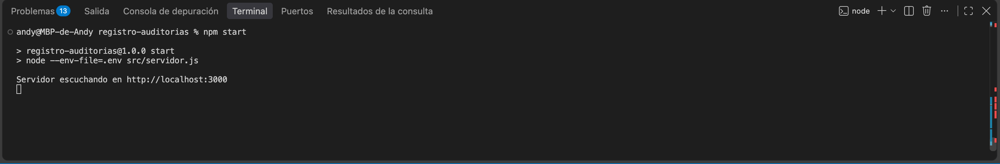
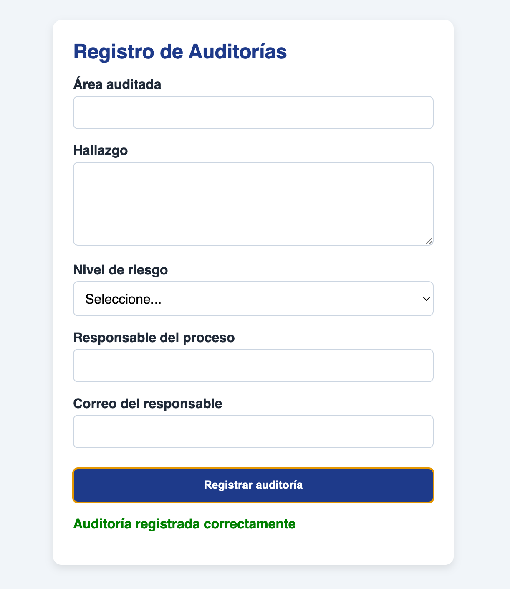
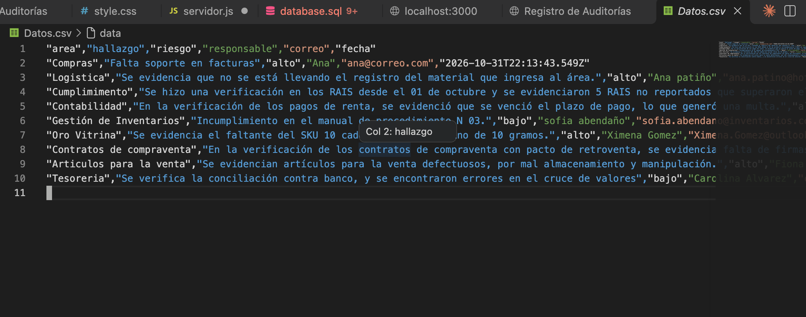
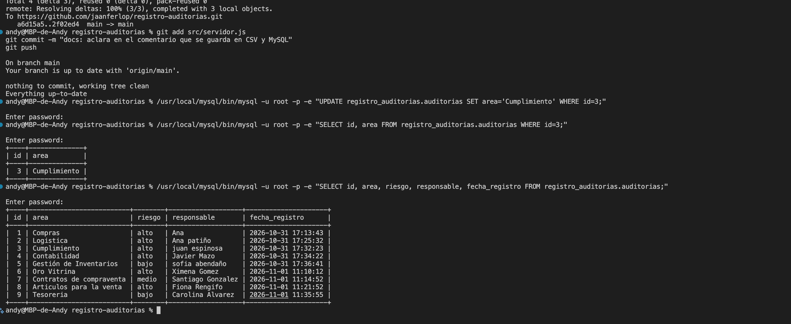

# Registro de Auditorías

Aplicación web para registrar los hallazgos de auditorías internas. Los datos se capturan en un formulario y se guardan al mismo tiempo en un archivo `Datos.csv` (respaldo) y en una base de datos MySQL.

Proyecto práctico de aula de la Unidad 2 — Lenguaje de Programación para la Web.

## Tecnologías

- **Frontend:** HTML5 semántico, CSS3 (responsivo, con variables) y JavaScript.
- **Backend:** Node.js con Express.
- **Base de datos:** MySQL (librería `mysql2`).
- **Archivo plano:** `Datos.csv`.

## Funcionamiento

1. El usuario llena el formulario: área auditada, hallazgo, nivel de riesgo, responsable del proceso y su correo.
2. El navegador valida los campos (`required`, `type="email"`, `minlength`) y envía los datos con `fetch` a `POST /registrar`.
3. El servidor crea un objeto `RegistroAuditoria` y lo valida de nuevo, porque la validación del navegador se puede saltar.
4. Si hay errores responde `400` con la lista de errores y no guarda nada.
5. Si es válido, agrega una línea a `Datos.csv` y luego inserta el mismo registro en MySQL.
6. Responde `201` si todo salió bien, o `500` si falló la escritura.

## Estructura del proyecto

```
registro-auditorias/
├── public/                     frontend
│   ├── index.html              formulario
│   ├── style.css               estilos
│   └── app.js                  envío del formulario con fetch
├── src/                        backend
│   ├── servidor.js             servidor Express y endpoint POST /registrar
│   ├── RegistroAuditoria.js    clase: encapsula, valida y convierte el registro a CSV
│   ├── AuditoriaRepositorio.js clase: acceso a MySQL (pool de conexiones)
│   └── importarCSV.js          pasa a MySQL los registros de Datos.csv
├── database.sql                script de creación de la base de datos y la tabla
├── Datos.csv                   registros de prueba
├── .env.example                modelo de las variables de entorno
└── package.json
```

## Programación orientada a objetos

- **`RegistroAuditoria`:** guarda los datos en campos privados (`#`), se valida con `validar()`, y se convierte con `toCSV()` y `datos()`.
- **`AuditoriaRepositorio`:** se encarga solo del acceso a MySQL. Usa un pool de conexiones y consultas parametrizadas (`?`) para evitar la inyección SQL.

## Requisitos

- [Node.js](https://nodejs.org/) 20.6 o superior (usa `--env-file`).
- MySQL 8 o superior, encendido.

## Instalación y ejecución

1. **Instalar las dependencias:**
   ```
   npm install
   ```

2. **Crear la base de datos y la tabla.** Desde la raíz del proyecto:
   ```
   mysql -u root -p < database.sql
   ```
   Si el comando `mysql` no está en el PATH (instalación en macOS con el instalador oficial), usa la ruta completa: `/usr/local/mysql/bin/mysql`.

3. **Crear el archivo `.env`** copiando `.env.example` y poniendo la contraseña de tu MySQL:
   ```
   cp .env.example .env
   ```
   El `.env` no se sube al repositorio.

4. **Iniciar el servidor:**
   ```
   npm start
   ```

5. **Abrir** http://localhost:3000 y registrar una auditoría.

## Modelo de datos

Tabla `auditorias` de la base `registro_auditorias`:

| Columna | Tipo | Detalle |
|---|---|---|
| `id` | `INT` | Clave primaria, autoincremental |
| `area` | `VARCHAR(100)` | Obligatorio |
| `hallazgo` | `TEXT` | Obligatorio, mínimo 10 caracteres (validado en la aplicación) |
| `riesgo` | `VARCHAR(10)` | Obligatorio: `bajo`, `medio` o `alto` |
| `responsable` | `VARCHAR(100)` | Obligatorio |
| `correo` | `VARCHAR(150)` | Obligatorio, con formato de correo |
| `fecha_registro` | `DATETIME` | Fecha del registro |

## Importar los registros del CSV a MySQL

Si hay registros en `Datos.csv` que no están en la base de datos:

```
node --env-file=.env src/importarCSV.js
```

El script omite los registros que ya existen, así que se puede ejecutar varias veces sin duplicar datos.

## Consultar los registros en MySQL

```
mysql -u root -p -e "SELECT * FROM registro_auditorias.auditorias;"
```

## Evidencias de prueba

**Consola:** servidor iniciado con `npm start`.



**Formulario:** registro guardado correctamente.



**Archivo `Datos.csv`:** una línea por registro, sin sobrescribir las anteriores.



**Tabla `auditorias` en MySQL:** los mismos registros guardados en la base de datos.



## Manejo de errores

- **`400`:** datos inválidos. La respuesta incluye la lista de errores.
- **`500`:** falló la escritura en el CSV o en MySQL. El error se imprime en la consola del servidor.
- Todo el endpoint está dentro de un `try/catch`, y el servidor no se detiene por un error.
